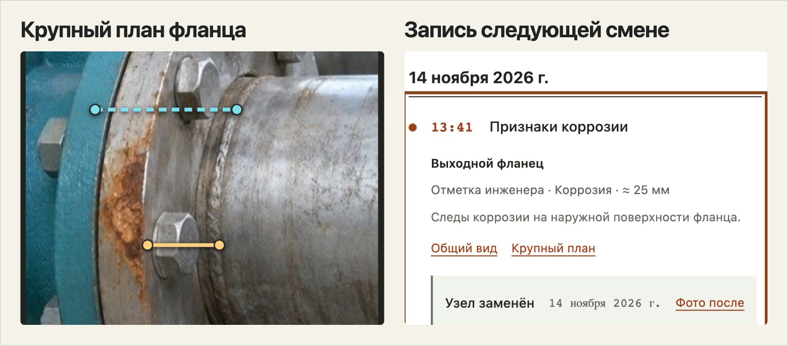
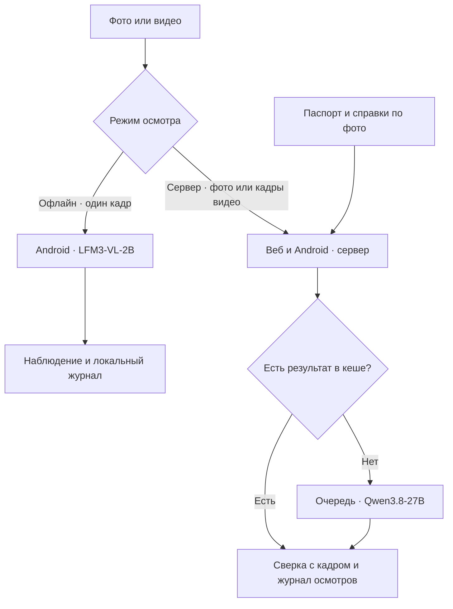

<div align="center">

# Cyber102

**Осмотр промышленного оборудования по фото и видео**

Инженер сканирует QR, снимает узел, сверяет наблюдение со страницей паспорта и сохраняет осмотр для следующей смены. На Android кадр можно проверить прямо на телефоне, даже без сети.

[Веб-демо P-102](https://cyber102.94.41.87.102.sslip.io/index.html?serial=P-102) · [Скачать Android APK](https://github.com/timuridrisiv874-code/cyber102/releases/tag/android-v0.14-test) · [Критерии жюри](docs/jury/criteria.md)

Команда **«Брови и ресницы»** · Кейс КСТ Энерго Инжиниринг

</div>



*Учебный P-102. На скриншоте показаны тестовый ответ модели и запись в журнале.*

## Семь ключевых возможностей

| Возможность | Что получает инженер |
| --- | --- |
| **Android-приложение** | Можно найти агрегат по QR или номеру, открыть его карточку, снять узел или выбрать файл. В приложении есть серверный режим с настраиваемым адресом и отдельный офлайн-режим. [APK и инструкция](android/README.md) |
| **RAG по паспортам и поиск по эмбеддингам** | DINOv2 находит похожее оборудование по фото или первому кадру видео. При анализе фото Qwen получает подходящие справки из локальной базы, а в интерфейсе видны источники. Паспорт выбранного агрегата имеет приоритет. [Визуальный поиск и RAG](docs/architecture/visual-search.md) · [Проверка на стенде](docs/ml/visual-rag-integration-2026-11-14.json) |
| **Обработка видео** | Интерфейс отбирает до восьми кадров. Сервер возвращает сводку, наблюдения и таймкоды. По таймкоду можно вернуться к нужному моменту, а опорный кадр сохранить в журнале. [Проверка ролика и таймкодов](tests/browser/clip-review-smoke.cjs) · [Сохранение осмотра](tests/browser/video-history-smoke.cjs) |
| **3D-реконструкция** | По видео обхода FFmpeg и Meshroom строят вращаемую модель. Предварительные метки коррозии и отслоения покрытия можно сверить с исходными кадрами, удалить или поставить вручную. Для реконструкции нужен сервер и видео с перекрывающимися ракурсами. [Пайплайн](server/mesh_service.py) · [Проверка меток](tests/browser/mesh-annotations-smoke.cjs) |
| **VLM на сервере** | Одна **Qwen3.8-27B Q4** на GPU обрабатывает фото и кадры видео. В ответе есть предполагаемый узел, видимый признак и область на кадре, когда модель может её указать. При недостатке данных ответ может быть неопределённым. [Конфигурация и замеры](vision_runtime/README.md) |
| **VLM на телефоне** | **LFM3-VL-2B** анализирует фото или выбранный кадр видео на CPU Android. Перевод на русский и журнал последних десяти текстовых осмотров тоже работают на устройстве. Для офлайн-показа заранее подготовьте веса. [Подготовка и запуск](android/README.md) |
| **Кеш на 7 дней и очередь** | При включённом дисковом кеше повтор одинакового анализа фото или видео может вернуть результат без нового вызова GPU. Кеш учитывает входные кадры, модель, её ревизию и контекст. Новые задачи фото и видео проходят через общую FIFO-очередь со статусом и позицией. [Кеш](server/result_cache.py) · [Очередь](server/analysis_queue.py) · [Проверка повторного запроса](tests/test_result_cache_api.py) |

## Новаторские идеи

### От фотографии к проверяемой рекомендации

- **Визуальный RAG.** DINOv2 кодирует снимок в вектор из 384 чисел и по косинусному сходству находит до трёх кандидатов. Для анализа фото в режиме `standard` Qwen получает локальные выдержки, связанные с этими кандидатами и с паспортом, если оператор его выбрал. В карточке сохраняются использованные источники и видно, какие из них найдены по фото. Серийный номер задаёт инженер, численные характеристики берутся из паспорта выбранного агрегата. В контрольном запросе снимок насоса серии КМ дал три справки, включая выдержку со страницы 17 руководства. [Как это работает](docs/architecture/visual-search.md) · [Результат запроса](docs/ml/visual-rag-integration-2026-11-14.json)
- **Рекомендация по конкретному узлу.** Для агрегата `21031004-1` карточка редуктора показывает марку масла VG220, объём 3,7 л и страницу паспорта. При выборе подшипника рекомендация о масле редуктора исчезает. В учебном P-102 рост вибрации и температуры приводит к запросу недостающего замера тока. [Сквозная проверка](tests/browser/gold-smoke.cjs)
- **Отметка на 3D с исходным кадром.** По ролику обхода строится вращаемая модель. На проверочной съёмке насосной станции сохранились две предварительные метки коррозии, на баке и опорной лапе. Инженер открывает исходный кадр и при необходимости исправляет разметку. Вне сети Android может обработать отдельный кадр с помощью LFM3-VL-2B, перевести наблюдение на русский и сохранить текст в локальный журнал. [Проверка 3D](docs/ml/ready-materials-validation-2026-11-14.md#3d-и-загрузка-видео) · [Офлайн-осмотр](android/README.md)

### Сравнение с аналогами

| Решение | Что есть в описанном сценарии |
| --- | --- |
| **1С:ТОИР «Мобильная бригада»** | Идентификация оборудования по QR/NFC, маршруты, регистрация дефектов и прикрепление фотографий. [Руководство](https://desnol.ru/upload/media/Mobile_TOIR_Manual.pdf) |
| **IBM Maximo / Inspector Portable** | Мобильный осмотр, компьютерное зрение для поиска аномалий и локальный инференс на iPhone и iPad в Inspector Portable. [Maximo](https://www.ibm.com/products/maximo/asset-inspection) · [Inspector Portable](https://www.ibm.com/products/inspector-portable) |
| **Cyber102** | Фото помогает подобрать справки для анализа, выбранный узел связывает рекомендацию со страницей паспорта, а 3D-метка открывает кадр для проверки. [RAG по фото](docs/architecture/visual-search.md) · [Проверка 3D-меток](tests/browser/mesh-annotations-smoke.cjs) |

## Что показать жюри

1. **Основной сценарий.** Откройте [осмотр P-102](https://cyber102.94.41.87.102.sslip.io/index.html?serial=P-102), проверьте кадр, уточните узел и сохраните осмотр. В [журнале](https://cyber102.94.41.87.102.sslip.io/checkpoint.html?serial=P-102) откройте исходный кадр, крупный план и фото после работ. Встроенные учебные примеры используют заданные ответы. Для проверки серверной VLM выберите собственное фото.
2. **Рекомендация с источником.** Для реального паспортного примера выберите агрегат `21031004-1` в [реестре оборудования](https://cyber102.94.41.87.102.sslip.io/documents.html). На редукторе покажите VG220, 3,7 л и страницу паспорта. Смените узел на подшипник и проверьте, что эта рекомендация исчезла. В учебном P-102 покажите, как рост вибрации и температуры приводит к запросу недостающего замера тока. [Проверка обоих сценариев](tests/browser/gold-smoke.cjs)
3. **Поиск по фото.** Загрузите снимок насоса из [готовых материалов](https://cyber102.94.41.87.102.sslip.io/materials.html), откройте «Похожее оборудование», запустите обычный анализ и покажите источники с пометкой «найдено по фото». [Сценарий проверки](tests/browser/visual-rag-smoke.cjs)
4. **Видео, 3D и очередь.** Загрузите короткий ролик, откройте находку по таймкоду и сохраните опорный кадр. Во второй сессии отправьте новое фото, пока сервер обрабатывает видео, и покажите позицию в очереди. Для 3D загрузите отдельный обход вокруг одного агрегата и откройте исходный кадр по метке. [Проверка очереди](tests/test_analysis_queue_api.py) · [Замер на стенде](vision_runtime/README.md)
5. **Офлайн на Android.** Заранее откройте офлайн-режим и дождитесь готовности модели. Включите авиарежим, сделайте снимок, получите наблюдение на русском и откройте сохранённую заметку во вкладке «Журнал». [Инструкция для показа](android/README.md)

Для двигателя `230201068` можно дополнительно показать расчёт наработки. Из паспортных 60 000 ч при текущих 12 000 ч остаётся 48 000 ч до назначенного ресурса. Карточка указывает страницу паспорта. [Проверка расчёта](tests/browser/motor-resource-smoke.cjs)

## Как устроен анализ



Результат VLM — предварительное наблюдение. Инженер сверяет его с изображением, паспортом и показаниями перед сохранением. Материалы демонстрационного P-102 и архив измерений описаны отдельно. [Происхождение данных](data/customer/README.md)

## Разработка и внедрение

**Стенд работает через HTTPS.** Серверная VLM Qwen3.8-27B Q4 выполняет анализ на RTX 3090 Ti, визуальный поиск DINOv2 работает отдельным CPU-процессом, осмотры и выполненные работы сохраняются в SQLite. В проекте предусмотрен запуск внутри сети предприятия. Для пилота понадобятся доступ к стенду из цеха, проверенные паспорта и привязка кадров и показаний к одному агрегату. [Конфигурация стенда](docs/operations/deployment.md) · [Развёртывание в локальной сети](docs/operations/local-network.md)

### Что измерили на стенде

| Операция | Результат |
| --- | --- |
| Анализ фото уплотнения | 4,14 с при первом запросе, 0,047 с при повторе из кеша |
| Анализ 8 кадров видео | 27,50–27,56 с при первом запросе, 0,109–0,125 с при повторе из кеша |
| Визуальный поиск по 63 изображениям | 143–215 мс через HTTPS в трёх контрольных запросах |
| 3D по видео обхода | 82 и 97 с на построение по метаданным двух готовых моделей. Повторный запрос готовой модели занял 0,032 и 0,047 с |

Это отдельные замеры на тестовых материалах. Время обхода и передачи смены нужно измерять отдельно, включая съёмку, загрузку, проверку результата и уточнения между сотрудниками. [Фото, видео, кеш и 3D](docs/ml/ready-materials-validation-2026-11-14.md) · [Замеры визуального поиска](docs/ml/visual-search-server-2026-11-14.json)

### Сколько времени должно экономить решение

Условный сценарий первого года принимает **10 000 осмотров**, **1 200 ₽ за час работы** и **400 000 ₽ совокупных затрат** на разработку, подготовку паспортов, оборудование, интеграцию, обучение и сопровождение.

| Доля осмотров в Cyber102 | Порог покрытия затрат высвобожденным временем | Эффект при экономии 5 минут на осмотр |
| --- | ---: | ---: |
| 100% | **2 мин** | ≈ 833 ч в год, эквивалент **1 000 000 ₽** |
| 50% | **4 мин** | ≈ 417 ч в год, эквивалент **500 000 ₽** |

Годовой эффект в денежном эквиваленте считается как экономия минут на одном осмотре × число осмотров × доля охвата × стоимость часа ÷ 60. Значения показывают стоимость высвобожденного времени. Фактические затраты, экономию времени и денежный эффект на предприятии ещё предстоит измерить. [Формула и допущения](docs/research/field-pilot.md#как-оценить-затраты-и-эффект)

**Как проверить на предприятии.** Три обходчика проходят по два сопоставимых задания, привычным способом и в Cyber102. Мастер без устной подсказки определяет агрегат, узел, выполненную работу и дату, затем открывает фото результата. Для каждого способа фиксируются суммарное время обходчика и мастера, доля записей, принятых с первого раза, и число ошибок привязки. Сравнение проводится при сопоставимой полноте осмотров, а время уточнений входит в расчёт. [Протокол и форма замеров](docs/research/field-pilot.md)

## Проверки и ограничения

- **Есть сквозные проверки** осмотра и журнала, паспортных ссылок, таймкодов, очереди, кеша и мобильной загрузки. [Команды и сценарии](tests/browser/README.md)
- **Есть замеры серверной модели.** В одном контрольном прогоне восемь кадров обработаны за 21,00 с, а фото второго клиента заняло 2,84 с после ожидания в очереди. На трёх синтетических роликах из 11 ориентиров модель нашла 3 точно, 4 частично и пропустила 4. [Протокол, конфигурация и ограничения](vision_runtime/README.md)

- Ранее на 53 фотографиях сравнили серверные модели: Qwen3-VL-4B указала проверяемые узел, признак и область на **38 снимках** по автоматической оценке. Текущая серверная модель — Qwen3.8-27B Q4; первые проверки совместимости и ограничения описаны в [журнале процесса модели](vision_runtime/README.md). Это эксперименты на тестовых материалах, а не подтверждённая точность на предприятии.
- Проверены сохранение осмотра и повторное открытие записи в браузере, а также офлайн-анализ на эмуляторе Android 15. Полевую проверку на оборудовании и физических телефонах ещё предстоит провести. [Сквозной тест](tests/browser/inspection-work-smoke.cjs) · [План полевой проверки](docs/research/field-pilot.md).

[**Шкала жюри**](docs/jury/criteria.md) содержит все уровни от 0 до 3 баллов по каждому из семи критериев, оба исходных скриншота и ссылки на материалы Cyber102 для проверки.

## Локальный запуск

Из корня репозитория:

```sh
python3 -m venv .venv
.venv/bin/python -m pip install -r requirements.txt
.venv/bin/python -m server.app --result-cache-dir var/result-cache
```

Откройте `http://127.0.0.1:8000/`. Для анализа новых кадров подготовьте отдельный [GPU-процесс и веса](vision_runtime/README.md). Исходные материалы заказчика размещаются отдельно. Для доступа к камере с телефона через сеть нужен доверенный HTTPS.

[Структура документации](docs/README.md) · [Формат данных и API](docs/architecture/database.md) · [Исследовательские материалы](docs/research/README.md) · [Проект для iPhone](ios/README.md)
