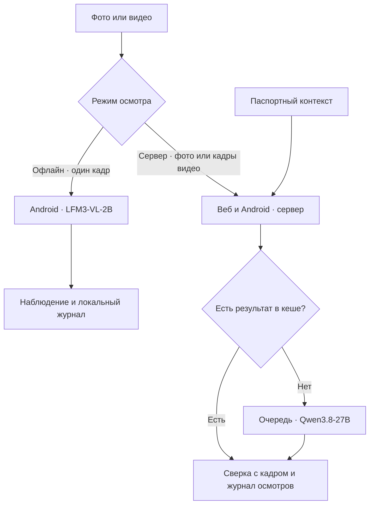

<div align="center">

# Cyber102

**Осмотр промышленного оборудования по фото и видео**

Инженер сканирует QR, снимает узел, сверяет наблюдение со страницей паспорта и сохраняет осмотр для следующей смены. На Android кадр можно проверить прямо на телефоне, даже без сети.

[Веб-демо P-102](https://cyber102.94.41.87.102.sslip.io/index.html?serial=P-102) · [Скачать Android APK](https://github.com/timuridrisiv874-code/cyber102/releases/tag/android-v0.14-test) · [Критерии жюри](docs/jury/criteria.md)

Команда **«Брови и ресницы»** · Кейс КСТ Энерго Инжиниринг

</div>


*Учебный P-102. На скриншоте показаны тестовый ответ модели и запись в журнале.*

## Семь ключевых возможностей

| Возможность | Что получает инженер |
| --- | --- |
| **Android-приложение** | Можно найти агрегат по QR или номеру, открыть его карточку, снять узел или выбрать файл. В приложении есть серверный режим с настраиваемым адресом и отдельный офлайн-режим. [APK и инструкция](android/README.md) |
| **RAG по паспортам и поиск по эмбеддингам** | В рабочем RAG отрывки подбираются по агрегату, узлу и тексту запроса. Фото и видео получают паспортный контекст, а в карточке можно открыть страницу PDF. Текущий поиск использует взвешенное совпадение слов и технические синонимы. Поиск по эмбеддингам пока не подтверждён в коде. [Поиск и контекст для VLM](server/knowledge.py) · [Проверки](tests/test_equipment_knowledge.py) |
| **Обработка видео** | Интерфейс отбирает до восьми кадров. Сервер возвращает сводку, наблюдения и таймкоды. По таймкоду можно вернуться к нужному моменту, а опорный кадр сохранить в журнале. [Проверка ролика и таймкодов](tests/browser/clip-review-smoke.cjs) · [Сохранение осмотра](tests/browser/video-history-smoke.cjs) |
| **3D-реконструкция** | По видео обхода FFmpeg и Meshroom строят вращаемую модель. Предварительные метки коррозии и отслоения покрытия можно сверить с исходными кадрами, удалить или поставить вручную. Для реконструкции нужен сервер и видео с перекрывающимися ракурсами. [Пайплайн](server/mesh_service.py) · [Проверка меток](tests/browser/mesh-annotations-smoke.cjs) |
| **VLM на сервере** | Одна **Qwen3.8-27B Q4** на GPU обрабатывает фото и кадры видео. В ответе есть предполагаемый узел, видимый признак и область на кадре, когда модель может её указать. При недостатке данных ответ может быть неопределённым. [Конфигурация и замеры](vision_runtime/README.md) |
| **VLM на телефоне** | **LFM3-VL-2B** анализирует фото или выбранный кадр видео на CPU Android. Перевод на русский и журнал последних десяти текстовых осмотров тоже работают на устройстве. Для офлайн-показа заранее подготовьте веса. [Подготовка и запуск](android/README.md) |
| **Кеш на 7 дней и очередь** | При включённом дисковом кеше повтор одинакового анализа фото или видео может вернуть результат без нового вызова GPU. Кеш учитывает входные кадры, модель, её ревизию и контекст. Новые задачи фото и видео проходят через общую FIFO-очередь со статусом и позицией. [Кеш](server/result_cache.py) · [Очередь](server/analysis_queue.py) · [Проверка повторного запроса](tests/test_result_cache_api.py) |

## Что показать жюри

1. **Основной сценарий.** Откройте [осмотр P-102](https://cyber102.94.41.87.102.sslip.io/index.html?serial=P-102), проверьте кадр, уточните узел и сохраните осмотр. В [журнале](https://cyber102.94.41.87.102.sslip.io/checkpoint.html?serial=P-102) откройте исходный кадр, крупный план и фото после работ. Встроенные учебные примеры используют заданные ответы. Для проверки серверной VLM выберите собственное фото.
2. **Рекомендация с источником.** Для реального паспортного примера выберите агрегат `21031004-1` в [реестре оборудования](https://cyber102.94.41.87.102.sslip.io/documents.html). На редукторе покажите VG220, 3,7 л и страницу паспорта. Смените узел на подшипник и проверьте, что эта рекомендация исчезла. В учебном P-102 покажите, как рост вибрации и температуры приводит к запросу недостающего замера тока. [Проверка обоих сценариев](tests/browser/gold-smoke.cjs)
3. **Видео, 3D и очередь.** Загрузите короткий ролик, откройте находку по таймкоду и сохраните опорный кадр. Во второй сессии отправьте новое фото, пока сервер обрабатывает видео, и покажите позицию в очереди. Для 3D загрузите отдельный обход вокруг одного агрегата и откройте исходный кадр по метке. [Проверка очереди](tests/test_analysis_queue_api.py) · [Замер на стенде](vision_runtime/README.md)
4. **Офлайн на Android.** Заранее откройте офлайн-режим и дождитесь готовности модели. Включите авиарежим, сделайте снимок, получите наблюдение на русском и откройте сохранённую заметку во вкладке «Журнал». [Инструкция для показа](android/README.md)

## Как устроен анализ



Результат VLM — предварительное наблюдение. Инженер сверяет его с изображением, паспортом и показаниями перед сохранением. Материалы демонстрационного P-102 и архив измерений описаны отдельно. [Происхождение данных](data/customer/README.md)

## Проверки и внедрение

- **Есть сквозные проверки** осмотра и журнала, паспортных ссылок, таймкодов, очереди, кеша и мобильной загрузки. [Команды и сценарии](tests/browser/README.md)
- **Есть замеры серверной модели.** В одном контрольном прогоне восемь кадров обработаны за 21,00 с, а фото второго клиента заняло 2,84 с после ожидания в очереди. На трёх синтетических роликах из 11 ориентиров модель нашла 3 точно, 4 частично и пропустила 4. [Протокол, конфигурация и ограничения](vision_runtime/README.md)
- **Есть схема внедрения и протокол пилота.** Для заводского контура предусмотрено развёртывание во внутренней сети. Протокол сравнивает работу обходчика и мастера, время и полноту передачи смены, а также оценивает порог окупаемости. Фактический эффект проверяется на предприятии. [Развёртывание](docs/operations/deployment.md) · [Пилот, аналоги и оценка затрат](docs/research/field-pilot.md)

[**Шкала жюри**](docs/jury/criteria.md) содержит все уровни от 0 до 3 баллов по каждому из семи критериев, оба исходных скриншота и ссылки на материалы Cyber102 для проверки.

## Локальный запуск

Из корня репозитория:

```sh
python3 -m venv .venv
.venv/bin/python -m pip install -r requirements.txt
.venv/bin/python -m server.app --result-cache-dir var/result-cache
```

Откройте `http://127.0.0.1:8000/`. Для анализа новых кадров подготовьте отдельный [GPU-процесс и веса](vision_runtime/README.md). Исходные материалы заказчика размещаются отдельно. Для доступа к камере с телефона через сеть нужен доверенный HTTPS.

[Структура документации](docs/README.md) · [Формат данных и API](docs/architecture/database.md) · [Исследовательские материалы](docs/research/README.md) · [Проект для iPhone](ios/README.md)
